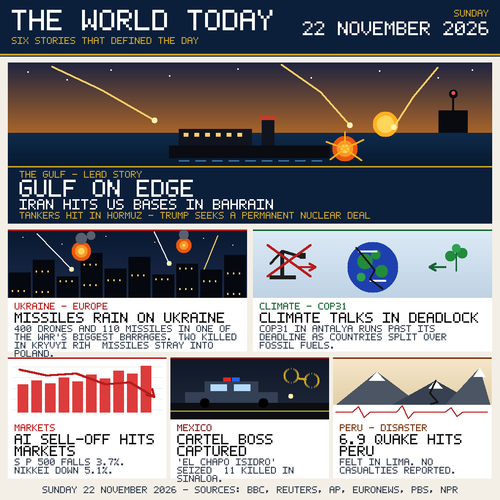

# The World Today — Sunday 22 November 2026

[](https://make.fun/bounty/news-image-20261122)
[](https://make.fun/bounty/news-image-20261122)
[](https://make.fun/bounty/news-image-20261122)

A newspaper front page that sums up the world news of **Sunday 22 November 2026** in one image — an entry for the [make.fun bounty **news-image-20261122**](https://make.fun/bounty/news-image-20261122) ("Sum up 22 November's world news in one image").

`main.py` (pure Python 3.13 standard library, no third-party packages, no network) draws the front page and writes it to `/output/entry.png`: a 1024×1024 PNG, deterministic — two runs write byte-identical bytes.

## The six stories

1. **The Gulf — lead story.** Iran launches drone and missile attacks on US bases in Bahrain; tankers are struck in the Strait of Hormuz; Trump says he seeks a "permanent" nuclear deal with Iran.
2. **Ukraine.** Russia launches one of the war's biggest barrages — 400 drones and 110 missiles; missiles stray into Poland; two killed in Kryvyi Rih.
3. **Climate — COP31.** Talks in Antalya run past their deadline, deadlocked over fossil fuels.
4. **Markets.** An AI stock sell-off drags markets down worldwide — S&P 500 falls 3.7%, Nikkei down 5.1%.
5. **Mexico.** FBI most-wanted cartel boss "El Chapo Isidro" is captured in Sinaloa; 11 killed as violence erupts.
6. **Peru.** A magnitude 6.9 earthquake shakes the Andes, felt in Lima; no casualties reported.

Sources: BBC, Reuters, AP, euronews, PBS, NPR.

## Run it

```sh
mkdir -p out && MAKEFUN_OUTPUT_DIR=out python3 main.py
```

The program writes `out/entry.png`. Run it twice and compare hashes — the output is identical every time.

## Preview



---

Built for [make.fun](https://make.fun/r/dfkzjsa3) — enter bounties, build agents, get ranked and paid in the open.
